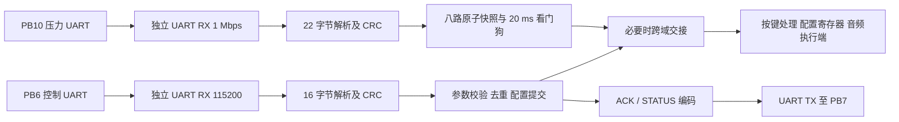

# 给下一个 AI：FPGA 接收与控制开发清单（基础/历史版本）

> 本文中的八路 `AA55` 是旧基础方案。当前 MCU 的演奏输入为 PCA9555 实体十二键 + 12 路 ADC，始终发送 `AA56`；控制帧部分仍可参考本文。当前输入协议请先读 [十二键实体钢琴接线与验收](十二键实体钢琴接线与验收.md)。

版本：2026-10-04。面向 STM32F429 + Sipeed Tang Primer 25K 电子乐器项目。

> 2026-10-15 新增十二键触摸钢琴模式。完成本文原有 `AA 55` 和控制链路后，必须继续阅读并实现同目录的 `给下一个AI_FPGA十二键触摸钢琴扩展.md`；其中定义了同一 1 Mbps 串口上的 `AA 56`、34 字节快照帧和两种输入源的切换规则。

**这份文档可以单独交给负责 FPGA 的 AI。请先实现与现有 MCU 固件兼容的双串口接收、控制回复、配置寄存器和下游接口，再接入已有音频逻辑。不要擅自更改帧格式，也不要只给原理说明。**

本文区分三个层次：**线协议**必须与 MCU 一致；**当前 MCU 行为**来自已实现源码；**RTL 建议**可按实际工程调整。

## 1. 当前状态与这次开发范围

已知情况：

- MCU 为 STM32F429BIT6，八路 ADC 原始压力，设计采样率每路 1 kHz。
- MCU 已实现压力帧发送、控制事务/重试、启动配置同步和基础触摸界面。
- MCU Keil ARMClang 6.22 编译通过，软件协议/状态机/模拟 DMA 测试通过。
- 用户确认旧工程屏幕此前显示、触摸正常；**本次新固件尚未烧录联调**。
- 当前 MCU 工作区没有可供核对的 FPGA RTL、管脚约束、FPGA 实际工作时钟或 I/O Bank 电压表。

本轮 FPGA 工作清单：

- [ ] 检查用户实际 FPGA 工程、器件、时钟、复位、工具链和已有 UART/音频模块。
- [ ] 实现两套独立 UART RX，以及控制链路的一套 UART TX。
- [ ] 实现压力帧解析、整组提交、链路失联保护。
- [ ] 实现控制帧解析、参数校验、配置提交、ACK/状态回复和重复请求去重。
- [ ] 输出清楚的压力、配置、释音事件接口，接入已有下游逻辑。
- [ ] 用自检 testbench 验证，再综合/布局布线；有板卡条件时再实机联调。
- [ ] 交付 RTL、testbench、约束与使用说明，并分别记录仿真、综合、时序、实机结果。

**仅完成通信与寄存器层时，应明确说明音频执行端尚未完成。能成功收包或写寄存器，不等于音色、ADSR 或 32 复音已经实现。**

## 2. 开始时需要查清的硬件信息

| 项目 | 要做什么 |
|---|---|
| FPGA 工程 | 优先复用现有 Gowin 工程、顶层、约束及 IP，不无故另起不兼容的工程 |
| 实际器件/板卡版本 | 从工程与板卡资料确认，不只凭 Tang Primer 25K 名称猜封装 |
| 主时钟 | 确认输入晶振、PLL 输出及约束频率，作为 CLK_HZ 参数来源 |
| 串口引脚 | 从原理图/接线表确定 FPGA package pin，再写 `.cst`；不能虚构脚号 |
| I/O 电压 | 确认 Bank 电压和电平标准与 MCU 信号兼容，共地 |
| 音频时钟域 | 明确与通信域是否同源/同域，决定是否需要异步 FIFO 或握手 |
| 传感器电路 | 阈值、力度方向、校准依赖真实电路，接收端先保存原始 12 位值 |

硬件资料不全时，继续完成参数化 RTL 和仿真；把缺失的引脚/时钟集中列出，不假称可以直接上板。

## 3. 实际接线与 UART 参数

| 信号 | MCU 实际引脚 | FPGA 方向 | 参数 |
|---|---|---|---|
| PRESSURE_RX | **PB10 / USART3_TX** | 输入 | **1,000,000 baud，8N1** |
| CTRL_RX | **PB6 / USART1_TX** | 输入 | **115,200 baud，8N1** |
| CTRL_TX | **PB7 / USART1_RX** | 输出 | **115,200 baud，8N1** |
| GND | MCU GND | 共地 | 信号参考 |

MCU 的 PB11/USART3_RX 虽已配置，但当前压力协议不需要回传，**不要向压力链路发送 ACK**。

- UART 空闲高电平，1 个低起始位，8 数据位，1 个高停止位，无校验、无流控。
- **UART 单字节按 bit0 先发；多字节整数按低字节先发。这与 CRC 算法是否反射是三件不同的事。**
- 接收到的是二进制帧，不是 ASCII 十六进制字符串，没有 CR/LF。
- 屏幕由 MCU 驱动；FPGA 控制串口只收设置命令，不收屏幕像素。
- 不要求 FPGA 与 MCU 共用晶振，UART RX 应允许合理的波特率误差。

UART RTL 建议：

- [ ] RX 外部引脚先做同步，再检测起始位；中点复核起始位和停止位。
- [ ] 使用系统时钟加 clock enable，不把普通逻辑分频信号随意当新时钟。
- [ ] 波特率分频由 CLK_HZ/BAUD 计算；需要时用分数累加器，不能把不整除的控制波特率简单截断而不评估误差。
- [ ] `rx_valid` 每字节一个时钟脉冲，配套 `rx_data[7:0]`；另输出 framing/break/overflow 诊断。
- [ ] TX 使用 ready/valid 或 start/busy 握手，发送期间保持数据所有权。
- [ ] 复位释放同步到本时钟域；CTRL_TX 复位/空闲时保持高。

## 4. 压力链路：22 字节固定帧

### 4.1 格式

下面全部字节编号从 0 开始。

| 字节 | 内容 |
|---|---|
| 0 | AA |
| 1 | 55 |
| 2～3 | uint16 采集序号，小端 |
| 4～5 | 键 1，uint16 小端，合法范围 0～4095 |
| 6～7 | 键 2 |
| 8～9 | 键 3 |
| 10～11 | 键 4 |
| 12～13 | 键 5 |
| 14～15 | 键 6 |
| 16～17 | 键 7 |
| 18～19 | 键 8 |
| 20～21 | CRC16 小端，**仅覆盖字节 2～19** |

对应传感器顺序固定：键 1～8 = PA0～PA7 = ADC1 IN0～IN7 = Rank 1～8。不要在 FPGA 端重新猜排序。

当前 MCU 每完成一轮采样，序号加 1；开机首次正常发布序号为 1，随后按 65536 回绕。链路异常拥塞时 MCU 只保留最新待发帧，所以**序号跳变不必然代表 CRC 错误**。

正常情况下约每 1 ms 一帧。1 Mbps 下每帧在线约 220 μs；两个帧之间通常有空闲，但**帧边界必须由协议识别，不能依赖固定空闲长度**。

### 4.2 必须实现的行为

- [ ] 先收满候选帧并校验 CRC，再检查八路高四位是否均为 0。
- [ ] 校验失败不更新任何通道、不刷新“最后合法压力帧”时间。
- [ ] 用 staging buffer 保存候选数据；有效时一次性更新八路快照和序号。
- [ ] 输出 `pressure_valid` 单周期脉冲；同周期八路值与 seq 一致、稳定。
- [ ] 序号用于诊断，不因为间断、回绕或 MCU 重启后的重新计数永久拒收数据。
- [ ] 正常 FFFF→0000 连续；重复 seq、其他差值分别记录。大差值可能是复位/乱序，不能武断算成大量真实丢包。
- [ ] 没有新帧时可保持最后快照供调试，但同时输出 link_alive，不能把旧值当新采样。
- [ ] 不逐帧 ACK，不等待控制链路空闲才接收压力。

### 4.3 重同步与失联

- 帧负载可能含 `AA 55`，**不能在有效候选帧中途看见帧头就重新开始**。
- 建议使用 22 字节滑动窗口或等效候选保留机制：失败时保留可能的新帧头后缀，能恢复丢字节、插入字节和截断帧。
- 可以加可配置的收包字节间超时，用于丢弃未收完的候选帧；这是本地接收器策略，不是新增线协议字段。测试其不会截断 MCU 正常连续 DMA 帧。
- **连续 20 ms 无合法压力帧：link_alive 清零，输出一次 pressure_timeout/release 请求，并记录故障。** 这是流失联看门狗，与字节间超时分开。
- 初始无帧时 link_alive=0；已建立链路后失联只产生一次事件，避免每个时钟重复释音。
- 恢复后，各键必须先观察到有效松开状态，再允许重新触发。阈值未知时由下游按键模块实现，每键维护“允许重新触发”状态。
- 控制链路断开本身不应让压力接收停机；保留最后确认的参数。

## 5. CRC：两条链路完全相同

固定算法为 **CRC-16/CCITT-FALSE**：

| 参数 | 值 |
|---|---|
| polynomial | 0x1021 |
| init | 0xFFFF，每帧重新初始化 |
| RefIn / RefOut | false / false |
| XorOut | 0x0000 |
| 字节处理顺序 | 从覆盖区第一个字节到最后一个字节 |
| CRC 在线顺序 | 低字节先发 |
| 检查字符串 | ASCII `123456789` → 数值 **0x29B1** |

等价伪代码：

```text
crc = 0xFFFF
for each byte in covered_bytes:
    crc = crc XOR (byte << 8)
    repeat 8 times:
        if crc bit15 is 1:
            crc = ((crc << 1) XOR 0x1021) AND 0xFFFF
        else:
            crc = (crc << 1) AND 0xFFFF
```

RTL 可以每字节组合展开，也可以分多个周期处理，但必须赶在下个字节到达前完成或配有 FIFO。不要把 header 或收到的 CRC 自身算进覆盖区。

**特别检查非阻塞赋值：处理最后一个参数字节时，比较/发送应使用包含该字节的 next_crc，而不是尚未更新的旧 crc 寄存器。**

## 6. 控制链路：16 字节固定帧

### 6.1 共用格式

请求、ACK 和状态回复均使用此格式。

| 字节 | 内容 |
|---|---|
| 0～1 | 5A A5 |
| 2 | 协议版本，当前 01 |
| 3 | 命令码 |
| 4～5 | uint16 事务序号，小端 |
| 6 | target：0 全局；1～8 压力键 |
| 7 | 保留，必须 00 |
| 8～13 | P0～P5，共六字节 |
| 14～15 | CRC16 小端，**仅覆盖字节 2～13** |

固定长度，不带 length 字段。未使用参数为 00，只有 SET_CHORD 的未使用音符槽是 FF。

解析阶段先确认完整候选帧和 CRC，再交给命令执行器做版本、命令、目标、参数校验。**不要直接照搬 MCU 接收回复的过滤方式：FPGA 收到 CRC 正确但版本不支持的请求，应回错误 ACK 1，而不是静默丢掉。**

控制负载/CRC 中同样可能有 `5A A5`；处理分段、连续帧、垃圾和坏 CRC 的要求与压力链路一致。

### 6.2 全部命令

| cmd | 名称 | target | P0～P5 | 当前 MCU 使用情况 |
|---|---|---|---|---|
| 00 | PING | 0 | 全 0 | 未同步/断线时探测 |
| 01 | SET_TIMBRE | 0 | P0=0 风琴类，1 拨弦类；其余 0 | 启动同步、界面 |
| 02 | SET_MASTER_GAIN | 0 | P0/P1=uint16 0～1000；其余 0 | 启动同步、滑条 |
| 03 | SET_TRANSPOSE | 0 | P0=int8 −24～+24；其余 0 | **启动同步必需**；钢琴页八度由 `AA 56 base_note` 表示，不走此命令 |
| 04 | SET_KEY_NOTE | 1～8 | P0=音符 0～127；其余 0 | 启动同步、键位编辑 |
| 05 | SET_MODE | 0 | P0=0 单音，1 和弦；其余 0 | **启动同步必需**；当前无模式编辑 |
| 06 | SET_CHORD | 1～8 | P0=音数 1～4；P1～P4=音符 0～127；未用音符槽 FF；P5=0 | **启动同步会给八键各发一次** |
| 07 | RELEASE_ALL | 0 | 全 0 | 界面停止当前发声 |
| 08 | SET_MUTE | 0 | P0=0 解除静音，1 静音；其余 0 | 启动同步、界面 |
| 10 | SET_ADSR_PARAM | 0 | P0=0 A/1 D/2 S/3 R；P1/P2=uint16；P3～P5=0 | 协议预留，当前界面不发送 |
| 20 | GET_STATUS | 0 | 全 0 | 同步后空闲约每秒查询 |

表中的命令码以十六进制书写。最小可联调版本应完成除 ADSR 可后接之外的上述命令。ADSR 尚未实现时应明确回复状态 2；当前启动流程不依赖它。

### 6.3 参数执行语义

- [ ] 增益是绝对线性值 `gain/1000`；例如 300 表示 30%，不是 dB。
- [ ] 移调是绝对半音数，不是“再加一次”；例如 −12 在线字节为 F4。
- [ ] 默认键位 `[60,62,64,65,67,69,71,72]`；音符编号仅借用 MIDI 音高定义，A4=69=440 Hz，本串口协议不是 MIDI。
- [ ] 计算“基础音符 + 移调”时显式做有符号扩展，用足够位宽保留负数和 127 以上结果；先检查再截位。
- [ ] SET_TRANSPOSE、SET_KEY_NOTE、SET_CHORD 更新候选配置后，验证所有有效键位/和弦音符经移调均在 0～127。无效则拒绝整次修改，原配置保持不变。
- [ ] 校验和弦时只检查 P0 指定的有效槽，其余槽必须 FF；不要把 FF 当作真实音符参与加法。
- [ ] SET_KEY_NOTE 和 SET_CHORD 分别修改独立的映射表，不自行把一个写操作扩展成修改另一个。
- [ ] ADSR：A/D/R=0～5000 ms，S=0～1000；0 ms 定义为立即进入下一阶段。两种音色的默认包络数值尚未由线协议规定，应从既有音频设计确定并记录。
- [ ] 音色、键位、移调、模式、和弦、ADSR 只影响之后新触发的音；切换音色载入该音色默认包络。
- [ ] 音量、静音可影响当前声部；下游宜做约 5 ms 平滑过渡。
- [ ] RELEASE_ALL 使当前声部进入释音，仍按住的键须先松开再按下才重新触发。
- [ ] 静音不等于停止跟踪按键/声部；避免解除静音时释放关系错乱。

通信层应把参数寄存器和事件端口真正实现出来，再由音频端消费。如果音频端尚未接好，在交付中标注“配置接收/存储已完成，声音行为待接入”，不伪装成音频功能验收通过。

## 7. 回复规则：必须双向通信

### 7.1 普通 ACK（cmd=80）

- 版本始终为 01。
- seq 和 target 原样对应请求。
- P0=原请求 cmd，P1=状态码，P2～P5=0。
- 按控制帧规则重新计算 CRC。

| 状态码，十进制 | 意义 |
|---|---|
| 0 | 成功，参数已提交/事件已被执行端可靠接收 |
| 1 | 版本不支持 |
| 2 | 命令不支持 |
| 3 | 目标错误 |
| 4 | 参数越界，含映射加移调越界 |
| 5 | 保留字段或未使用参数非法 |
| 6 | 暂时忙，**本次没有执行** |

CRC 错误的请求不回复。对 CRC 正确的非法请求，应给出错误 ACK，不能先部分修改寄存器再报错。

多种错误同时出现时，选择固定校验优先级并在 testbench 中一致使用。例如：版本 → 命令 → 目标 → 保留/未用字段 → 数值及完整映射范围；线协议未限定多错误的优先顺序。

### 7.2 GET_STATUS 成功回复（cmd=81）

| 参数 | 内容 |
|---|---|
| P0 | 当前已提交音色，0/1 |
| P1 | 当前已提交模式，0/1 |
| P2 | 当前已提交 int8 移调 |
| P3 | 当前已提交静音，0/1 |
| P4～P5 | 当前已提交总增益 uint16 小端，0～1000 |

seq/target 对应请求，版本 01、保留字节 00。**成功只回 81，不再多发一个成功 80 ACK。** 错误时仍回普通 80 ACK。

这条回复没有键位、和弦或 ADSR 字段，不要自行追加长度，也不要返回尚未提交的候选配置。发送过程中使用锁存的状态快照，避免前后字段来自不同版本。

### 7.3 时序、重试和去重

当前 MCU 已实现：

- 同时最多一个在途事务；另有 8 条有界待发队列。
- 从请求最后一个字节真正发送完成开始等待 **20 ms**。
- 超时最多重发 2 次，**总共最多发送 3 次**；内容与 seq 保持不变。
- BUSY 状态 6 后退避 **5 ms**，也受总尝试次数限制。
- 其他明确错误不盲目重试；只有成功回复才更新对应已确认值。

FPGA 必须做到：

- [ ] 在 20 ms 预算内使 MCU 收到完整回复；普通 16 字节回复本身约占 1.39 ms，不能到第 20 ms 才启动 TX。
- [ ] 更新“新触发音配置”即可确认，不需要等用户按键、声部空闲或整段包络结束。
- [ ] 缓存最近一个终结请求及其完整回复。比较完整请求内容，不能只比较 seq。
- [ ] 对完全相同的重试只重发原回复，不再次提交、清包络或产生 RELEASE_ALL 脉冲。
- [ ] 终结回复可以含成功/确定性错误；BUSY 不缓存成已完成事务。
- [ ] 同 seq 但不同内容不能误命中缓存；按新候选请求校验处理，不擅自新增协议错误码。
- [ ] 接受 seq 回绕、MCU 重启后的从 1 开始；不要求全局单调递增。
- [ ] 正在提交的请求收到完全相同重试时，合并等待/复用该事务结果，不能产生两次提交。已经接受、将会提交的操作也不能又声称“BUSY，未执行”。
- [ ] 回复 TX 的当前缓冲和待发回复分开；发送中不能覆盖，缓冲队列有界。
- [ ] 跨域提交的确认对应实际交接完成；不能寄存器尚未生效就发成功 ACK。

协议没有会话号或 FPGA 启动计数器，无法完美区分所有重启与旧请求。只实现上述兼容行为，不偷偷加字段。

## 8. 最关键的兼容点：MCU 的 22 步上电同步

**不能只实现 PING、音色和音量。缺少 SET_TRANSPOSE、SET_MODE 或 SET_CHORD，会让现有 MCU 同步失败。**

当前固件从全新启动、没有故障的情况，会按下表发送；每条成功后才发下一条。步骤号不是永久固定的事务 seq；仅第一次无异常启动时两者恰好从 1 同步递增。

| 步骤 | 命令 | target | 参数 |
|---|---|---|---|
| 1 | SET_MUTE | 0 | 1，先静音 |
| 2 | SET_TRANSPOSE | 0 | 0 |
| 3 | SET_TIMBRE | 0 | 期望音色，默认 0 |
| 4～11 | SET_KEY_NOTE | 1～8 | 逐键期望音符，默认 60/62/64/65/67/69/71/72 |
| 12～19 | SET_CHORD | 1～8 | `01 note FF FF FF 00`，逐键单音和弦初值 |
| 20 | SET_TRANSPOSE | 0 | 期望移调，默认 0 |
| 21 | SET_MODE | 0 | 当前默认 0 |
| 22 | SET_MASTER_GAIN | 0 | 期望增益，默认 300，即 `2C 01 00 00 00 00` |

- 完成后 MCU **不会自动解除静音**，需要用户点击屏幕静音按钮，确认采集正常后再发 SET_MUTE=0。
- 第一页有音色、音量、八键音高、静音、全部释音和重新同步；第二页有十二键、整体八度、静音和全部释音。暂无和弦编辑、模式编辑、ADSR 编辑；第二页细节见十二键扩展文档。
- 对启动所需命令只写空 ACK 会造成“UI 显示已同步、FPGA 参数仍错误”；必须落实对应配置寄存器。
- FPGA 建议复位值：音色 0，模式 0，移调 0，gain=300，mute=1，默认八键如上，每键和弦初始一个默认音符。
- 不要求第一条请求一定是 PING，也不要求压力流必须等待同步结束；两条链路可以同时有数据。
- 同步成功后 MCU 空闲约每秒 GET_STATUS；失联时 PING 探测，重连后先静音同步。
- 状态查询发现全局配置与 MCU 确认值不一致，MCU 也会启动静音同步。不能把 PING 成功等同于配置已同步。

## 9. 建议 RTL 分层与下游端口

这些是实现建议，信号名可配合现有工程调整；线协议不能随意调整。



| 建议模块 | 职责 |
|---|---|
| uart_rx | 参数化 UART 接收，两份独立实例 |
| uart_tx | 控制回复发送 |
| crc16_ccitt_false | 按字节更新 CRC 的 function/模块 |
| pressure_frame_rx | 22 字节候选、校验和原子快照 |
| pressure_watchdog | 合法帧超时、link_alive、一次性失联事件 |
| control_frame_rx | 16 字节重同步，输出 CRC 正确的原始请求 |
| control_executor | 请求校验、候选配置、完整映射范围检查、去重、提交/事件 |
| control_reply_tx | 80/81 组帧、CRC、回复缓冲管理 |
| cdc_bridge（按需） | 完整快照/配置/事件的跨时钟域交接 |
| mcu_link_top | 三根 UART 引脚、模块连接、调试计数 |

建议提供给下游：

| 接口 | 要求 |
|---|---|
| pressure[0..7]，各 12 位 | 与原始 ADC 顺序一致 |
| pressure_seq[15:0] | 对应整组快照 |
| pressure_valid | 成功提交时一次脉冲 |
| pressure_link_alive | 不能仅根据 RX 线上有跳变置位 |
| pressure_timeout_event | 从在线进入失联时一次事件 |
| timbre/mode/transpose/gain/mute | 已提交配置，位宽和 signed 定义明确 |
| key_note[0..7] | 每键基础音符 |
| chord_count[0..7] / chord_note[0..7][0..3] | 有效槽与空槽分开管理 |
| cfg_commit / cfg_version（内部） | 提交事件或内部配置版本；不能擅自加入串口协议 |
| release_all_event | 每个新的成功请求只产生一次 |
| fault/rearm 信息 | 下游实现失联/释音之后的“松开再触发” |

跨域要求：

- [ ] RX 引脚的同步器只用于串行输入同步，不能把它当成多位数据快照的 CDC 方案。
- [ ] 多位压力/配置使用 bundled-data 握手或异步 FIFO，不把每位各过两级寄存器就当成一致快照。
- [ ] 使用握手时，源端从发起请求到收到确认期间必须保持整组数据稳定；新压力到来时另存 pending 最新值，不能覆盖在途数据。
- [ ] 接收域用同一次交接的数据一次性提交；事件脉冲跨域需可靠握手/事件 FIFO。
- [ ] 若整个工程采用一个系统时钟、音频用 sample enable，则优先在同域提交，避免不必要的 CDC。
- [ ] 配置可在音频采样边界提交；协议寄存器/readback 与执行端生效点要有明确一致关系。

建议诊断计数：压力合法帧、坏 CRC、非法高位、seq 异常、失联次数；控制合法帧、坏 CRC、非法请求、重复请求、BUSY、已提交数、回复数、UART framing/overflow。通过调试端口/片上逻辑分析仪查看，不把日志文本混入 CTRL_TX。

## 10. 可直接喂给 testbench 的十六进制向量

以下均为**真正的字节序列**；每个字节在线按 UART bit0 先发。不要把空格或文本字符一起发给 FPGA。CRC 已用独立 Python 计算核对。

### 10.1 压力：seq=1

八路 `[120,1000,20,2048,55,3000,18,4095]`：

```text
AA 55 01 00 78 00 E8 03 14 00 00 08 37 00 B8 0B 12 00 FF 0F 98 04
```

预期：八路同时更新一次，seq=1；不发送 UART 回复。

### 10.2 设置音色 1：seq=1

请求：

```text
5A A5 01 01 01 00 00 00 01 00 00 00 00 00 20 75
```

成功 ACK：

```text
5A A5 01 80 01 00 00 00 01 00 00 00 00 00 C3 24
```

### 10.3 首条静音：seq=1

请求：

```text
5A A5 01 08 01 00 00 00 01 00 00 00 00 00 E7 0F
```

成功 ACK：

```text
5A A5 01 80 01 00 00 00 08 00 00 00 00 00 21 6C
```

### 10.4 键 1 和弦初值：seq=12，音符 60

请求：

```text
5A A5 01 06 0C 00 01 00 01 3C FF FF FF 00 8F 93
```

成功 ACK：

```text
5A A5 01 80 0C 00 01 00 06 00 00 00 00 00 6A 23
```

### 10.5 总增益 300：seq=22

请求：

```text
5A A5 01 02 16 00 00 00 2C 01 00 00 00 00 AC 54
```

成功 ACK：

```text
5A A5 01 80 16 00 00 00 02 00 00 00 00 00 4F 62
```

### 10.6 状态查询示例：seq=23

请求：

```text
5A A5 01 20 17 00 00 00 00 00 00 00 00 00 9A A5
```

当前状态为音色 0、模式 0、移调 0、静音 1、gain=300 时，回复：

```text
5A A5 01 81 17 00 00 00 00 00 00 01 2C 01 99 3A
```

这是一条示例事务，不表示 MCU 的每次 GET_STATUS 序号永远是 23。

## 11. 分阶段实施与验收清单

### 阶段 A：UART 和压力通路

- [ ] UART 单字节/连续字节，起始位误触发、停止位错误和复位测试。
- [ ] CLK_HZ 参数下计算波特率误差，并仿真合理的收发时钟偏差及起始相位。
- [ ] 文档压力向量得到精确八路值，一帧只提交一次。
- [ ] 八路不同测试模式、0/4095、高四位非法值、seq 回绕与跳变。
- [ ] 坏 CRC 不改快照，不刷新合法帧计时。
- [ ] 垃圾、半帧、插字节、丢字节、连续坏帧之后能恢复到后续有效帧。
- [ ] 压力合法负载可跨字段包含 AA 55，例如 seq=0x55AA；解析不能被提前打断。
- [ ] 模拟 1000 帧/秒持续输入，控制链路同时工作时压力通路不漏收、不混合快照。
- [ ] 超过 20 ms 无合法帧产生一次失联事件；正常帧恢复后每键先松开再重新触发。

### 阶段 B：控制闭环

- [ ] 所有向量的请求/回复逐字节一致，包含 CRC。
- [ ] 完整重放 22 步 MCU 启动流程，每条成功后检查对应寄存器，最终保持静音。
- [ ] PING、音色、音量、键位、移调、模式、和弦、静音、RELEASE_ALL、GET_STATUS 均有正常路径。
- [ ] 各命令的错误 target、越界参数、保留字节、未用参数、和弦 FF 槽逐项测试。
- [ ] 加移调后的负数和超过 127 的映射拒绝，原配置完整保持。
- [ ] CRC 错请求无回复；CRC 正确但版本错误回复状态 1。
- [ ] GET_STATUS 只回 81；错误时回 80；状态快照是已提交值。
- [ ] 控制负载可含 5A A5，例如 PING seq=0xA55A；合法候选不被错误截断。
- [ ] 丢掉第一次 ACK，重发同一请求：重复回复而只提交一次。
- [ ] 对 RELEASE_ALL 重试，事件计数只增加 1。
- [ ] 同 seq 不同内容、seq 回绕、MCU 从 1 重启，均不错误命中旧缓存。
- [ ] BUSY 未执行、不缓存完成，5 ms 后重试能继续正常处理。
- [ ] TX 忙时接收重试/请求，当前回复内容和 CRC 不被后续包覆盖。
- [ ] 在最后字节接收完成后的 20 ms 预算内发送完整回复。

### 阶段 C：下游与跨域

- [ ] 压力、配置跨域后仍保持整组一致，不丢事件。
- [ ] 音色/键位修改只作用于后续新音，正在发声的旧事件仍能正确释放。
- [ ] 同键重按是新事件，压力更新不能重新影响旧的释音声部。
- [ ] RELEASE_ALL 和压力超时之后，仍按住的键不能立即重新起音。
- [ ] 静音期间仍跟踪按键；解除静音不会制造错误释放/触发。
- [ ] 控制失联不拖死压力通路；参数保留最后确认值。
- [ ] 若音频逻辑未接入，对事件消费者使用自检模型，交付时标明“接口仿真通过，音频执行尚未验证”。

### 阶段 D：实际板卡联调

- [ ] 综合和布局布线通过；时钟约束与实际输入一致，无非预期 latch/多驱动/未约束关键路径。
- [ ] 记录资源占用、最高/目标频率和时序结果；确认约束中的三根 UART 引脚和电压。
- [ ] 逻辑分析仪观察 PB10 / PB6 / PB7，验证两种波特率、帧长、字节顺序及回复时间。
- [ ] MCU 上电完成同步，屏幕不再停在 SYNC/FAILED，仍处于静音。
- [ ] 用户手动解除静音；八路压力分别变化，界面修改音色/音量/键位后 readback 对应变化。
- [ ] 持续刷屏、拖动音量时压力链路稳定；用真实帧率/seq/CRC 统计作证据。
- [ ] 断开控制与压力链路分别验证；MCU/FPGA 各自复位后验证恢复流程。
- [ ] 记录尚未验证的项目；有真实音频链路后再测端到端演奏延迟。

## 12. 最终交付要求

请交付：

- [ ] 可综合 RTL 和实际顶层集成，不只给分散代码片段。
- [ ] 清楚的 CLK_HZ/BAUD/看门狗/缓冲深度参数与复位说明。
- [ ] 对应现有器件和已确认接线的 `.cst`/`.sdc`；未确认信息不能伪造。
- [ ] 自检 testbench、测试向量生成/运行命令、通过/失败日志。
- [ ] 配置寄存器、下游数据接口和 CDC 的使用说明。
- [ ] 与本文件命令表、22 步同步流程的逐项兼容结论。
- [ ] 综合/时序报告与实机验证记录，分别说明，不相互冒充。
- [ ] 若只完成通信层，明确列出尚未连接的按键识别、音色、包络、混音、I²S 等执行端。

## 13. MCU 源码核对入口（有原工作区时使用）

本文件已包含编写 FPGA 接收端所需的完整线协议。以下文件方便追查，不是阅读本文的必要前提。

MCU 根目录：`C:/Users/xifan/Desktop/嵌赛FPGA单片机部分`。

| 路径 | 用途 |
|---|---|
| Core/Src/instrument_protocol.c | 实际压力/控制序列化、小端、请求参数校验 |
| Core/Inc/instrument_protocol.h | 命令码 |
| Core/Src/protocol_crc.c | 实际 CRC 算法 |
| Core/Src/pressure_acq.c、pressure_link.c | 八路快照、seq、压力发送 |
| Core/Src/control_client.c | ACK 匹配、超时、重试、BUSY 处理 |
| Core/Inc/control_client.h | 20 ms 超时、5 ms 退避常量 |
| Core/Src/instrument_settings.c | **SyncMessage：22 步同步的实际来源** |
| Core/Src/control_transport.c | 控制 UART DMA 接收与发送 |
| tests/test_protocol_control.c | MCU 协议与控制事务测试向量 |
| tests/test_settings.c | 同步流程与配置状态测试 |
| tools/check_pressure_capture.py | 检查 PB10 原始二进制抓包，支持 `AA 55`、`AA 56` 和来源切换 |
| docs/F429开发与验收说明.md | MCU 工程配置和上板步骤 |

给接手 AI 的起始指令：**请先检查我的 FPGA 现有工程，按本清单实现两路 UART 接收、压力整帧提交和控制回复。特别确保支持现有 MCU 的 22 步静音同步；缺少硬件脚号时先完成参数化 RTL 与自检仿真，再集中列出待确认项。不要擅自改 MCU 协议或把通信通过说成整套音频功能已经实现。**
